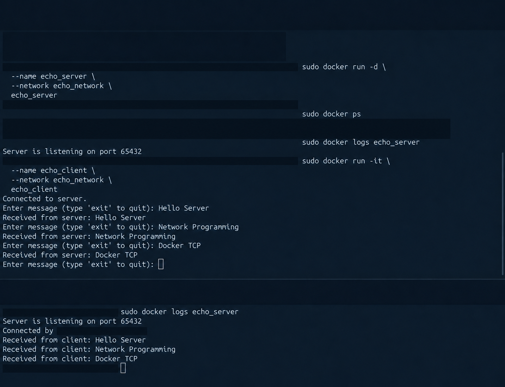
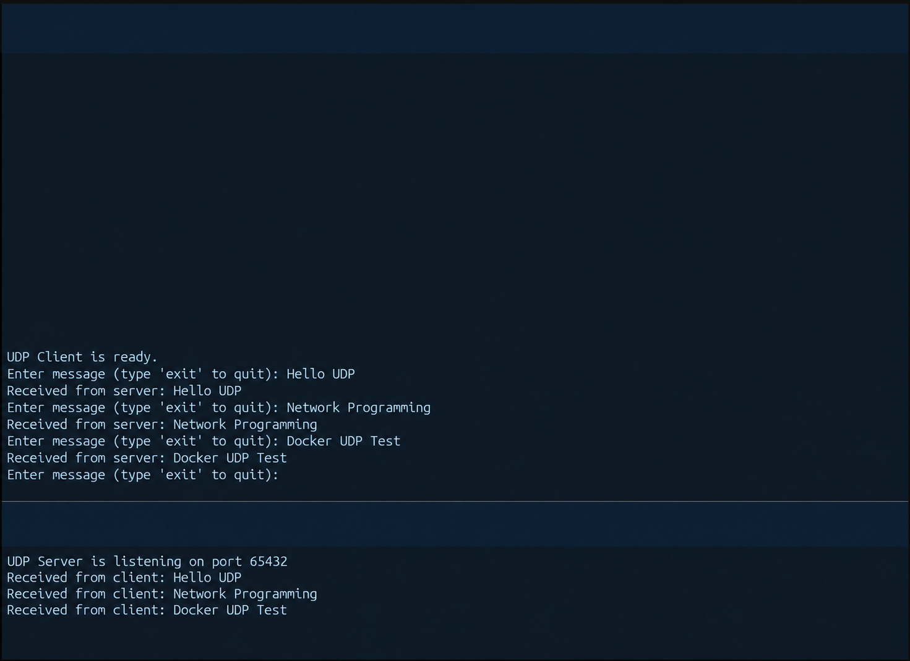

# TCP and UDP Echo Lab

A small network-programming project demonstrating Python sockets and communication between Docker containers. It began as a university lab and is kept deliberately simple: compare a connection-oriented TCP echo service with a datagram-based UDP echo service, then inspect their behavior and limitations.

**Stack:** Python standard library, Linux, Docker. No third-party Python packages are required. The examples use Python 3.11 container images.

## What it does

- TCP: accept one client connection, echo received byte chunks, then stop when the client disconnects.
- UDP: receive datagrams continuously and echo each payload to its sender.
- Interactive clients: send text, display the echoed response, and stop when you type `exit` (case-insensitive).
- Docker: use named containers on user-defined bridge networks so clients can resolve server names.

```text
tcp_echo_server/   TCP server/client and their Dockerfiles
udp_server_test/   UDP server/client and their Dockerfiles
screenshots/      Original manual lab demonstration images
tests/            Dependency-free checks with mocked socket I/O
```

## Prerequisites

For the automated tests: Python 3.11 or newer is the intended baseline; no Docker or network access is needed. For the manual container exercise: Docker Engine/CLI running with permission to build/run containers. Building images may download a Python base image. The commands below are documentation, not evidence of a new container run during portfolio preparation.

## Safe automated checks

From the repository root:

```sh
python3 -B -m unittest discover -s tests -v
```

The tests run the original scripts with mocked socket I/O and input. They check multiple-message echo behavior, UTF-8 text, client exit without sending it, TCP disconnection, UDP sender routing, and empty datagrams. They open **no real sockets**, bind no ports, install nothing, and do not run Docker.

These are script-level contract checks, not real transport, timing, DNS, or container integration tests. No network concurrency or arbitrary TCP framing guarantee is implied.

## Manual TCP container exercise

Run every command in this section from the **repository root**:

```sh
docker network create echo_network
docker build -f tcp_echo_server/Dockerfile.server -t echo_server tcp_echo_server
docker build -f tcp_echo_server/Dockerfile.client -t echo_client tcp_echo_server
docker run -d --name echo_server --network echo_network echo_server
docker run --rm -it --name echo_client --network echo_network echo_client
```

Send a few short text messages such as `hello` and `network lab`. Each should be echoed unchanged. Type `exit` to close the client; the TCP server handles this one connection and then exits. Inspect its output with:

```sh
docker logs echo_server
```

## Manual UDP container exercise

Again, run from the **repository root**, independently of the TCP exercise:

```sh
docker network create udp_network
docker build -f udp_server_test/Dockerfile.server -t udp_server udp_server_test
docker build -f udp_server_test/Dockerfile.client -t udp_client udp_server_test
docker run -d --name udp_server --network udp_network udp_server
docker run --rm -it --name udp_client --network udp_network udp_client
```

Send short text messages and compare the replies. Type `exit` to close the client. The UDP server remains running until explicitly stopped:

```sh
docker logs udp_server
```

No host ports are published by these commands. Each server binds port `65432` on all interfaces **inside its container**; the client connects using Docker DNS names `echo_server` or `udp_server`. The two examples use separate Docker networks, so sharing the numeric port does not conflict.

## Cleanup and troubleshooting

After finishing an exercise, remove only the containers and networks created for that exercise:

```sh
# TCP resources
docker rm -f echo_server
docker network rm echo_network

# UDP resources
docker rm -f udp_server
docker network rm udp_network
```

Clients started with `--rm` disappear after they exit. If a client is still running, exit it before removing its network. Images remain for reuse. Do not run a system-wide prune to clean this lab.

- **Name already in use / network already exists:** inspect `docker ps -a` and `docker network ls`. Reuse a suitable lab network or clean up your prior lab resources before repeating commands. Do not remove unrelated resources.
- **Client cannot resolve server:** confirm both containers use the same named network and the exact documented server container name. These names are not normal host DNS names.
- **Connection refused:** inspect server logs and status. The TCP server must be restarted before a second client session after the first disconnects.
- **Client waits indefinitely:** there are no receive timeouts. Interrupt with Ctrl+C, inspect server/network state, and retry only after correcting the cause.
- **Running without Docker:** `python3 tcp_echo_server/echo_server.py` or the UDP equivalent starts a server on all host interfaces. The unchanged clients still expect Docker DNS names. For dependency-free local verification, prefer the mocked test command above rather than starting these host services.

## Protocol comparison and educational limits

| Property | TCP | UDP |
| --- | --- | --- |
| Socket type | `SOCK_STREAM` | `SOCK_DGRAM` |
| Connection | Established connection | Per-datagram sender/address |
| Delivery semantics | Reliable, ordered byte stream | Delivery/order not guaranteed |
| Message boundaries | Application must define framing | Datagram boundaries preserved within buffer limits |
| This server | One connection, then exit | Continuous sequential receive/reply |

The TCP client assumes a short response fits one `recv(1024)`. TCP can split or combine data, so it does not guarantee one read per message or complete large-message echoes. UDP receives at most 1024 bytes per call and may truncate larger datagrams. Both examples assume UTF-8 text and lack timeout/retry, robust error handling, authentication, encryption, configurable endpoints, and production concurrency. They are teaching examples, not internet-facing services.

## Original manual evidence

These are privacy-redacted derivatives of the original lab screenshots, not new runtime captures. Terminal identities, personal paths, identifiers, and unrelated environment details are masked; the displayed TCP/UDP messages and matching replies were visually checked against the original evidence. The [screenshot privacy record](docs/SCREENSHOT_PRIVACY_PLAN.md) describes the approved Option A cleanup and its limits. Older unredacted copies remain in Git history because history was intentionally not rewritten.





The portfolio preparation adds documentation and automated contract checks while preserving all four teaching scripts and Dockerfiles unchanged.
